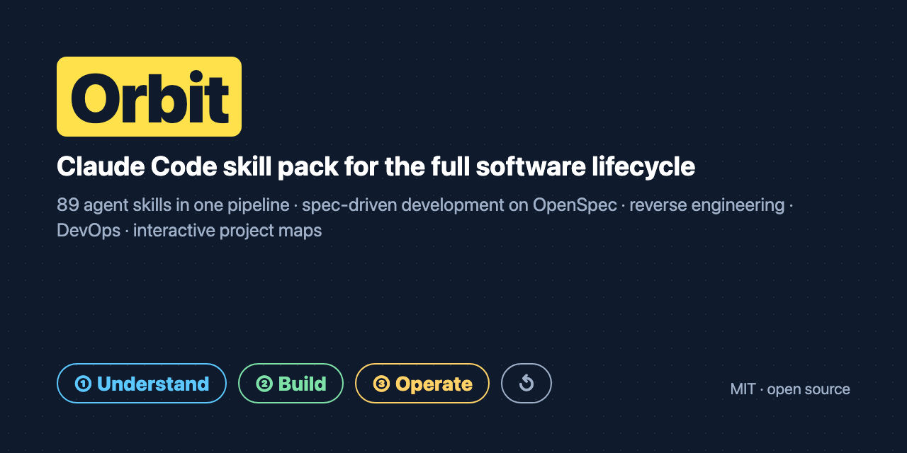
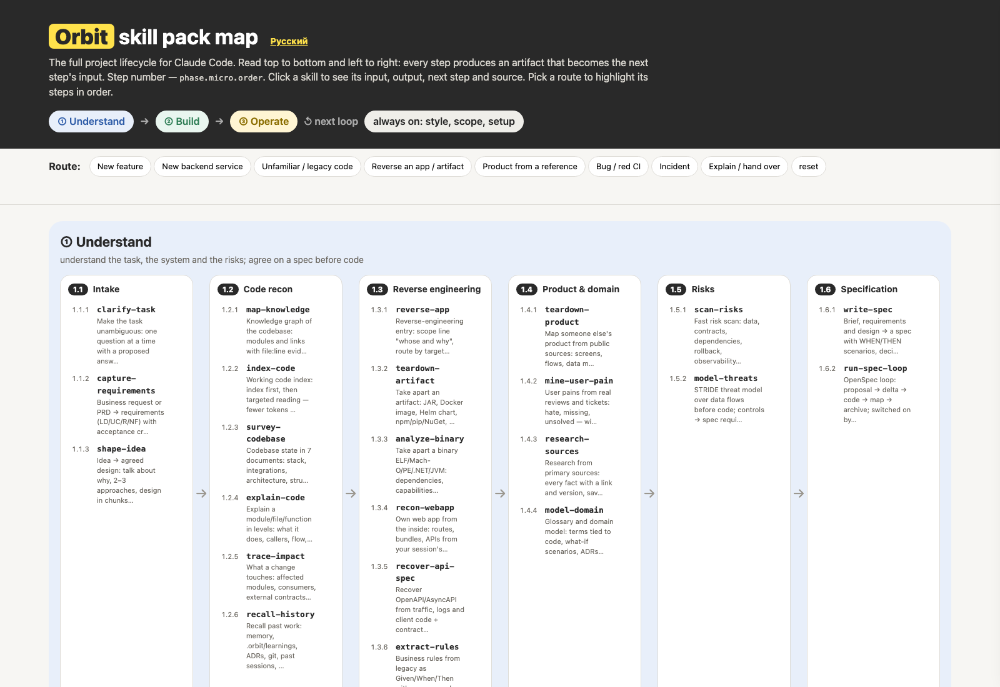

# Orbit — Claude Code skill pack for the full software lifecycle



**English** · [Русский](README.ru.md) · [Website & interactive map](https://tojim00d.github.io/Orbit-skills/) · [Catalog](CATALOG.md)

[](#install)
[](CATALOG.md)
[](LICENSE)
[](AGENTS.md)
[](https://tojim00d.github.io/Orbit-skills/)
[](CONTRIBUTING.md)
[](https://github.com/tojim00d/Orbit-skills/actions/workflows/validate.yml)

**Orbit** is an open-source **Claude Code plugin** with **89 agent skills** (SKILL.md) that run end to end: clarify the task → understand the codebase → spec-driven development on **OpenSpec** → test-first implementation → code and security review → release on Kubernetes → project map, docs and incident response. It also includes a **reverse engineering** toolkit for apps, Docker images, JARs, Helm charts and binaries.

> One install. 89 skills of its own, linked into one pipeline. Take any project from *"what are we actually asked to do?"* to *"it runs in production, and everyone understands how"* — with an artifact at every step.

```
① Understand  →  ② Build  →  ③ Operate  →  ↺ next loop
```

## At a glance

| | |
|:--|:--|
| **89** skills, each with a step number, an input, an output and a next step | **3** phases: Understand → Build → Operate |
| **8** ready routes: feature, service, legacy, reverse, product, bug, incident, hand-over | **18** community packs and the ASD-STE100 standard studied; every skill credits its sources |
| **1** shared artifact folder, `.orbit/` — work survives new sessions | **MIT** licence, open source, no telemetry |
| **Agent-agnostic** skills; native Claude Code plugin | [AGENTS.md](AGENTS.md) for Codex, Qwen Code, DeepSeek and any `SKILL.md` loader |

**Contents:** [What it is for](#what-it-is-for) · [How it works](#how-it-works--one-pipeline-not-a-pile-of-skills) · [See the map](#see-the-map) · [What it can do](#what-it-can-do) · [Repository layout](#repository-layout) · [Install](#install) · [FAQ](#faq) · [Community](#community-and-contributing)

## What it is for

Coding agents are strong at writing code and weak at everything around it: clarifying the task, reading an unfamiliar system, agreeing on a spec, proving the result works, explaining it to people, and keeping that knowledge alive. Orbit gives Claude Code a **complete, ordered method** for the whole lifecycle, so a feature, a migration or a legacy rescue runs the same reliable way every time.

- **Engineers** — fewer wrong assumptions, smaller diffs, tests first, "done" only with evidence.
- **Teams and leads** — one route per task, specs before code, a project map that stays in sync with the code.
- **Platform / DevOps** — Kubernetes, Helm, GitOps, CI triage, incidents, runbooks, artifact and binary analysis.
- **Onboarding** — knowledge graph of the codebase, onboarding guide, interactive project map.

## How it works — one pipeline, not a pile of skills

- **Phases → micro-phases → steps.** Every skill has a step number (`phase.micro.order`), an input, an output, the next skill and the skills it works with.
- **Shared artifacts.** Every step reads the previous step's output and writes its own into one folder, `.orbit/` (brief, plan, evidence, review, knowledge graph, findings, learnings — see `ARTIFACTS.md`). Work survives a new session or a hand-over.
- **A router.** `/orbit:orbit <task>` sizes the task. Small things are done at once; real work gets a 3–7 step route you approve.
- **8 ready-made routes:** new feature, new backend service, legacy code, reverse an app or artifact, product from a reference, bug / red CI, incident, explain / hand over.
- **Always-on conventions:** plain-language answers, work only inside the agreed scope, team commit format, small complete changes, no "done" without proof.

Open **`map/index.html`** — the pack map: phases, numbered steps, route buttons that light up the steps in order. Full list: **`CATALOG.md`**.

## See the map

A single self-contained page: the whole pack on one screen — phases, numbered steps, and routes that light up the steps in order. It ships in the repo, works offline, and is published as a site.

[](https://tojim00d.github.io/Orbit-skills/map.html)

## What it can do

| Capability | Skills |
|---|---|
| Clarify a fuzzy task | `clarify-task`, `capture-requirements`, `shape-idea` |
| Understand a codebase | `map-knowledge` (knowledge graph), `index-code`, `survey-codebase`, `explain-code`, `trace-impact`, `recall-history` |
| **Reverse engineering** | `reverse-app`, `teardown-artifact` (JAR, Docker, Helm, npm/pip, APK, Electron), `analyze-binary`, `recon-webapp`, `recover-api-spec`, `extract-rules` |
| Product & domain | `teardown-product`, `mine-user-pain`, `research-sources`, `model-domain` |
| Risks & spec | `scan-risks`, `model-threats`, `write-spec`, `run-spec-loop` (OpenSpec: proposal → delta → code → map → archive) |
| Design | `design-backend`, `design-data`, `design-services`, `choose-stack`, `shape-modules`, `deepen-modules`, `plan-rebuild`, `rebuild-clean`, `add-code-mode`, `build-mcp` |
| UI | `pick-ui-style`, `build-design-system`, `style-ui`, `craft-frontend`, `rebuild-design` |
| Build | `plan-steps`, `slice-tickets`, `prototype-fast`, `test-first`, `run-plan`, `delegate-tasks`, `run-parallel`, `isolate-branch`, `code-backend`, `build-screens`, `build-backend` |
| Debug & prove | `find-root-cause`, `fix-ci`, `prove-done`, `request-review`, `handle-review`, `review-code`, `cut-complexity`, `review-security`, `test-flows`, `check-parity` |
| Ship | `finish-branch`, `open-mr`, `ship-k8s` |
| Explain & document | `project-map` (interactive HTML map), `project-diagram` (static SVG/PNG), `draw-stack`, `publish-design-docs`, `onboard-people`, `teach-topic`, `cowrite-doc`, `instruct-agents`, `create-skill`, `write-update` |
| Remember & operate | `keep-learnings`, `handoff-session`, `run-retro`, `track-debt`, `compress-context`, `review-observability`, `write-runbook`, `handle-incident`, `triage-issues` |
| Always on | `orbit`, `speak-plain`, `think-first`, `keep-it-small`, `stay-in-scope`, `commit-clean`, `write-human`, `setup-repo` |

## What it is made of — references, not copies

Every Orbit skill is **its own**: own name, own method text (in English), written for this pipeline. Where a method comes from a community pack, the skill says so in **«Based on»** (pack, repository, licence) and explains what was improved in **«What's improved»**: merged duplicates, removed weaknesses, added checks, connected inputs and outputs.

Methods were studied in: superpowers (obra), Matt Pocock's skills, Replica, backend-skills, Skills by Anthropic, UI UX Pro Max, Ponytail, stack-diagram, code-mode, Humanizer, Karpathy guidelines, claude-mem, Headroom, Understand Anything, Graft/Trail-code, GSD, REA, Craft Anything, plus the ASD-STE100 plain-language standard. Helper tools that do real work (search over a UI database, parity and screenshot diff, contrast checker, Playwright helpers, MCP evaluation, skill validation) are shipped unchanged in `tools/` with their original licence. Full table: [CREDITS.md](CREDITS.md).

## Repository layout

```
Orbit-skills/
├── README.md · README.ru.md      what Orbit is, install, FAQ — EN / RU
├── AGENTS.md                     entry point for non-Claude agents (Codex, Qwen, DeepSeek…)
├── COMPATIBILITY.md              which agents and models work, and how — EN / RU
├── CATALOG.md · CATALOG.ru.md    all 89 skills in pipeline order — EN / RU
├── ARTIFACTS.md                  the shared .orbit/ folder contract
├── CREDITS.md                    sources and licences of every borrowed method
├── plugins/orbit/                the Claude Code plugin
│   ├── commands/                 /orbit:understand, /orbit:map, /orbit:reverse
│   ├── agents/                   cartographer and reverse-analyst subagents
│   └── skills/<verb-name>/       89 skills, one SKILL.md per folder (+ optional tools/)
├── map/                          the pack map — offline, one file
├── docs/                         GitHub Pages site (landing + map, EN / RU)
├── assets/                       social preview and screenshots
├── scripts/validate_pack.py      structure and link checks, also run in CI
├── scripts/make_badges.py        regenerates the local SVG badges
└── install.sh                    Claude Code plugin, or any agent's skills directory
```

## Install

Requires [Claude Code](https://claude.com/claude-code). One install, no other packs needed:

```bash
claude plugin marketplace add tojim00d/Orbit-skills
claude plugin install orbit@orbit
```

Restart Claude Code and type `/orbit:orbit <task>` — or just describe the task and the router picks it up.

Prefer a local clone? Same thing:

```bash
git clone https://github.com/tojim00d/Orbit-skills.git orbit
claude plugin marketplace add ./orbit
claude plugin install orbit@orbit
```

| Command | What it does |
|---|---|
| `/orbit:orbit <task>` | Propose a route and walk you through it |
| `/orbit:understand <repo>` | Knowledge graph + overview of a codebase |
| `/orbit:map <repo>` | Interactive project map |
| `/orbit:reverse <target + why>` | Reverse-engineer an app, artifact or binary |
| `/orbit:<skill>` | Run any single skill |

## Compatibility

Native on **Claude Code** — plugin, slash commands and subagents. The 89 skills are standard `SKILL.md` folders, so the same pack runs with other agents and models:

| You use | How to run Orbit |
|---|---|
| Claude Code — with Claude, or GLM / Z.ai, Qwen, DeepSeek via an Anthropic-compatible endpoint | Install the plugin; use the `/orbit:…` commands |
| OpenAI Codex, Qwen Code, Cursor, other IDE agents | Read `AGENTS.md`; copy skills with `./install.sh --skills-dir <dir>` |
| Any agent that loads the Agent Skills format | Point it at `plugins/orbit/skills/` |

Full table, caveats and model notes: [COMPATIBILITY.md](COMPATIBILITY.md) · [COMPATIBILITY.ru.md](COMPATIBILITY.ru.md).

## FAQ

**What is Orbit?**
A free, MIT-licensed skill pack (plugin) for Claude Code: 89 agent skills organized as one pipeline — Understand → Build → Operate — with shared artifacts in `.orbit/`.

**How do I install Claude Code skills from Orbit?**
`claude plugin marketplace add <path-or-repo>` then `claude plugin install orbit@orbit`, restart Claude Code and type `/orbit:orbit`. See [Install](#install).

**How is Orbit different from other Claude Code skill packs?**
Most packs are collections of independent skills. Orbit is a **sequenced pipeline**: every skill has a step number, an input, an output and a next step, and all skills share one artifact folder — so a task survives new sessions and hand-overs. It merges the best methods of 18 community packs and the ASD-STE100 standard (superpowers, Matt Pocock's skills, Anthropic skills, UI UX Pro Max, Replica, backend-skills and more), rewritten and improved, with references in every skill.

**Does it support spec-driven development?**
Yes. `write-spec` and `run-spec-loop` implement SDD on **OpenSpec**: proposal → requirement delta → code → project map → archive.

**Can Claude Code do reverse engineering with Orbit?**
Yes, for your own or authorized targets: `reverse-app`, `teardown-artifact` (Docker/OCI images, JAR/WAR, Helm, npm/pip/NuGet, APK, Electron), `analyze-binary` (ELF/Mach-O/PE/.NET/JVM), `recon-webapp`, `recover-api-spec` (traffic → OpenAPI), `extract-rules` (legacy business rules).

**Does it help DevOps and SRE work?**
Yes: `ship-k8s` (Kubernetes, Helm, GitOps with Argo CD/Flux), `fix-ci`, `review-observability`, `write-runbook`, `handle-incident`, `review-security`.

**Can it draw architecture diagrams and project maps?**
Yes: `project-map` builds an interactive one-file HTML map with numbered steps and links to code; `project-diagram` renders static SVG/PNG diagrams; `draw-stack` draws stack diagrams with logos.

**Does it work with Codex, Cursor or other agents?**
Orbit is native to Claude Code (plugin, commands, subagents) and model-agnostic: GLM, Qwen and DeepSeek work through a Claude Code–compatible endpoint. The 89 skills are plain `SKILL.md` folders, so Codex, Qwen Code, Cursor and other agents can read them directly — see [AGENTS.md](AGENTS.md) and [COMPATIBILITY.md](COMPATIBILITY.md).

**Is it free?**
Yes, MIT for Orbit's own work; borrowed helper tools keep their original licences (see [CREDITS.md](CREDITS.md)).

## Keywords
Claude Code skills · Claude Code plugin · agent skills · SKILL.md · skill pack · AI coding agent workflow · spec-driven development · OpenSpec · TDD · code review · security review · reverse engineering · Docker image analysis · Kubernetes · Helm · GitOps · project map · architecture diagram · onboarding · incident response

## Language and model

- Skill instructions are in **English** — cheaper in tokens and read equally well by every model. Claude **answers in the user's language** (Russian for Russian speakers). Descriptions carry trigger phrases in Russian and English, so skills fire on requests in either language. Human-facing docs (README, demo, pack map) are bilingual.
- Built for **Claude Code**, model-agnostic in practice: tested with Claude, used with GLM, Qwen, DeepSeek and other models through a compatible endpoint. Offensive security is deliberately not included. Reverse engineering is scoped to own or authorised targets (own/company code, open source, integrations, authorised audits); DRM, licence-check and authentication bypass are out of scope.


## If Orbit is useful

Star the repo, share the [website](https://tojim00d.github.io/Orbit-skills/) with your team, or open an issue with what's missing — all three help more engineers find Orbit.

## Community and contributing

- **[CONTRIBUTING.md](CONTRIBUTING.md)** — add a skill, the format, pull-request rules.
- **[CODE_OF_CONDUCT.md](CODE_OF_CONDUCT.md)** — Contributor Covenant 2.1.
- **[SECURITY.md](SECURITY.md)** — private vulnerability reporting.
- **[CREDITS.md](CREDITS.md)** — sources and licences.

New skills, fixes, translations and better examples are welcome. Before opening a PR, run `python3 scripts/validate_pack.py`; CI runs the same check.
