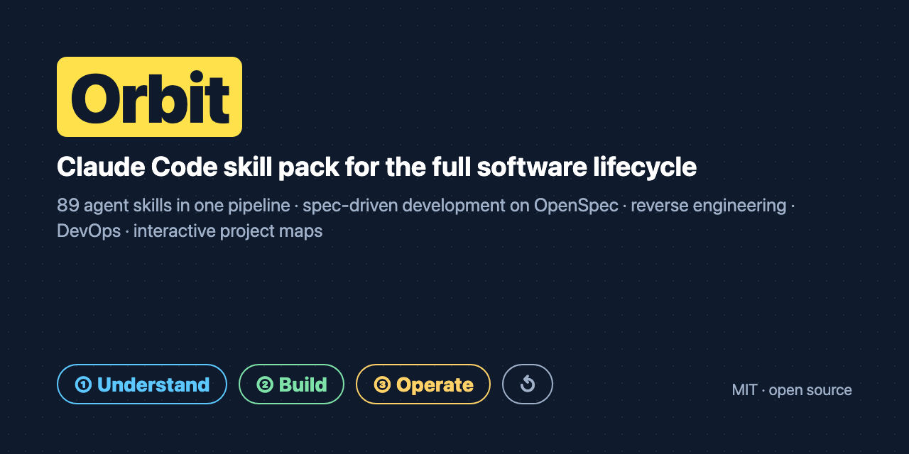
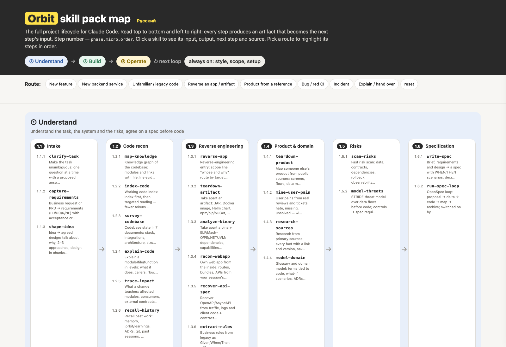

# Orbit — пак полного цикла для Claude Code



[English](README.md) · **Русский** · [Сайт и интерактивная карта](https://tojim00d.github.io/Orbit-skills/) · [Каталог](CATALOG.ru.md)

[](#установка)
[](CATALOG.ru.md)
[](LICENSE)
[](AGENTS.md)
[](https://tojim00d.github.io/Orbit-skills/index.ru.html)
[](CONTRIBUTING.md)
[](https://github.com/tojim00d/Orbit-skills/actions/workflows/validate.yml)

> Одна установка — 89 своих скиллов, связанных в один конвейер. Любой проект проходит путь от «что вообще просят?» до «работает в проде, и все понимают как». На каждом шаге получается артефакт.

```
① Разобраться  →  ② Разработать  →  ③ Сопровождать  →  ↺ новый виток
```

## Коротко

| | |
|:--|:--|
| **89** скиллов: у каждого номер шага, вход, выход и следующий шаг | **3** фазы: Разобраться → Разработать → Сопровождать |
| **8** готовых маршрутов: фича, сервис, легаси, реверс, продукт, баг, инцидент, передача | **18** паков сообщества и стандарт ASD-STE100 изучены; в каждом скилле указаны источники |
| **1** общая папка артефактов `.orbit/` — работа переживает новые сессии | **MIT**, открытый код, без телеметрии |
| **Скиллы без привязки к агенту**; нативный плагин Claude Code | [AGENTS.md](AGENTS.md) для Codex, Qwen Code, DeepSeek и любого загрузчика `SKILL.md` |

**Содержание:** [Для чего](#для-чего) · [Как устроен](#как-устроен--один-конвейер-а-не-куча-скиллов) · [Карта пака](#карта-пака) · [Что умеет](#что-умеет) · [Структура репозитория](#структура-репозитория) · [Установка](#установка) · [Совместимость](#совместимость) · [Частые вопросы](#частые-вопросы) · [Сообщество](#сообщество-и-участие)

## Для чего

Код агенты пишут хорошо. Хуже у них со всем остальным: уточнить задачу, разобраться в чужой системе, договориться о спеке, доказать, что работает, объяснить людям и сохранить знание. Orbit даёт Claude Code **полный упорядоченный метод** на весь цикл: фича, миграция или спасение легаси каждый раз идут одним надёжным путём.

- **Инженерам** — меньше неверных допущений, малые diff, сначала тесты, «готово» только с доказательством.
- **Командам и лидам** — общий маршрут для задач, спека раньше кода, карта проекта синхронна с кодом.
- **Платформе и DevOps** — Kubernetes, Helm, GitOps, разбор CI, инциденты, runbook, разбор артефактов и бинарников.
- **Новичкам в проекте** — граф знаний кода, гид онбординга, интерактивная карта.

## Как устроен — один конвейер, а не куча скиллов

- **Фазы → микрофазы → шаги.** У каждого скилла есть номер шага (`фаза.микрофаза.порядок`), вход, выход, следующий скилл и связанные скиллы.
- **Общие артефакты.** Каждый шаг читает выход предыдущего и пишет свой в одну папку `.orbit/`: бриф, план, доказательства, ревью, граф знаний, находки, выученное (см. `ARTIFACTS.md`). Работа переживает новую сессию и передачу коллеге.
- **Маршрутизатор.** `/orbit:orbit <задача>` оценивает размер. Мелкое делается сразу, для настоящей работы — маршрут из 3–7 шагов, ты его утверждаешь.
- **8 готовых маршрутов:** новая фича, новый бэкенд-сервис, легаси-код, реверс приложения или артефакта, продукт по образцу, баг или красный CI, инцидент, объяснить или передать.
- **Постоянные установки:** простой язык ответов, работа только в оговорённых границах, формат коммитов команды, малые полные изменения, «готово» только с доказательством.

Открой **`map/index.html`** — карта пака: фазы, номера шагов и кнопки маршрутов, которые подсвечивают шаги по порядку. Полный список — **`CATALOG.md`**.

## Карта пака

Одна самодостаточная страница: весь пак на одном экране — фазы, номера шагов и маршруты, которые подсвечивают шаги по порядку. Лежит в репозитории, работает офлайн и опубликована как сайт.

[](https://tojim00d.github.io/Orbit-skills/map.ru.html)

## Что умеет

| Возможность | Скиллы |
|---|---|
| Уточнить задачу | `clarify-task`, `capture-requirements`, `shape-idea` |
| Разобраться в коде | `map-knowledge` (граф знаний), `index-code`, `survey-codebase`, `explain-code`, `trace-impact`, `recall-history` |
| **Реверс-инжиниринг** | `reverse-app`, `teardown-artifact` (JAR, Docker, Helm, npm/pip, APK, Electron), `analyze-binary`, `recon-webapp`, `recover-api-spec`, `extract-rules` |
| Продукт и домен | `teardown-product`, `mine-user-pain`, `research-sources`, `model-domain` |
| Риски и спека | `scan-risks`, `model-threats`, `write-spec`, `run-spec-loop` (OpenSpec: proposal → дельта → код → карта → archive) |
| Проектирование | `design-backend`, `design-data`, `design-services`, `choose-stack`, `shape-modules`, `deepen-modules`, `plan-rebuild`, `rebuild-clean`, `add-code-mode`, `build-mcp` |
| Интерфейс | `pick-ui-style`, `build-design-system`, `style-ui`, `craft-frontend`, `rebuild-design` |
| Реализация | `plan-steps`, `slice-tickets`, `prototype-fast`, `test-first`, `run-plan`, `delegate-tasks`, `run-parallel`, `isolate-branch`, `code-backend`, `build-screens`, `build-backend` |
| Отладка и проверка | `find-root-cause`, `fix-ci`, `prove-done`, `request-review`, `handle-review`, `review-code`, `cut-complexity`, `review-security`, `test-flows`, `check-parity` |
| Выпуск | `finish-branch`, `open-mr`, `ship-k8s` |
| Объяснение и документы | `project-map` (интерактивная карта), `project-diagram` (статичная SVG/PNG), `draw-stack`, `publish-design-docs`, `onboard-people`, `teach-topic`, `cowrite-doc`, `instruct-agents`, `create-skill`, `write-update` |
| Память и эксплуатация | `keep-learnings`, `handoff-session`, `run-retro`, `track-debt`, `compress-context`, `review-observability`, `write-runbook`, `handle-incident`, `triage-issues` |
| Поверх всего | `orbit`, `speak-plain`, `think-first`, `keep-it-small`, `stay-in-scope`, `commit-clean`, `write-human`, `setup-repo` |

## Из чего собран — референсы, а не копии

Каждый скилл Orbit **свой**: своё имя, свой текст метода (на английском), написанный под этот конвейер. Если метод пришёл из пака сообщества, в скилле есть раздел **«Based on»** (пак, репозиторий, лицензия) и раздел **«What's improved»**: слиты дубли, убраны слабые места, добавлены проверки, связаны входы и выходы.

Изученные методы: superpowers (obra), скиллы Matt Pocock, Replica, backend-skills, Skills by Anthropic, UI UX Pro Max, Ponytail, stack-diagram, code-mode, Humanizer, Karpathy guidelines, claude-mem, Headroom, Understand Anything, Graft/Trail-code, GSD, REA, Craft Anything, а также стандарт простого языка ASD-STE100. Рабочие инструменты (поиск по базе UI-решений, подсчёт паритета и сравнение скриншотов, проверка контраста, помощники Playwright, оценка MCP, валидация скиллов) лежат без изменений в `tools/` с исходной лицензией. Полная таблица — [CREDITS.md](CREDITS.md).

## Структура репозитория

```
Orbit-skills/
├── README.md · README.ru.md      что такое Orbit, установка, FAQ — EN / RU
├── AGENTS.md                     вход для не-Claude агентов (Codex, Qwen, DeepSeek…)
├── COMPATIBILITY.md              какие агенты и модели работают и как — EN / RU
├── CATALOG.md · CATALOG.ru.md    все 89 скиллов по порядку конвейера — EN / RU
├── ARTIFACTS.md                  контракт общей папки .orbit/
├── CREDITS.md                    источники и лицензии каждого заимствованного метода
├── plugins/orbit/                плагин Claude Code
│   ├── commands/                 /orbit:understand, /orbit:map, /orbit:reverse
│   ├── agents/                   сабагенты cartographer и reverse-analyst
│   └── skills/<verb-name>/       89 скиллов, по одному SKILL.md в папке (+ tools/)
├── map/                          карта пака — офлайн, один файл
├── docs/                         сайт GitHub Pages (лендинг + карта, EN / RU)
├── assets/                       соцпревью и скриншоты
├── scripts/validate_pack.py      проверка структуры и ссылок, она же в CI
├── scripts/make_badges.py        пересобирает локальные SVG-бейджи
└── install.sh                    плагин Claude Code или папка скиллов любого агента
```

## Установка

Нужен [Claude Code](https://claude.com/claude-code). Одна установка, другие паки не нужны:

```bash
claude plugin marketplace add tojim00d/Orbit-skills
claude plugin install orbit@orbit
```

Перезапусти Claude Code и набери `/orbit:orbit <задача>` — или просто опиши задачу, маршрутизатор её подхватит.

Хочешь локальную копию — так же:

```bash
git clone https://github.com/tojim00d/Orbit-skills.git orbit
claude plugin marketplace add ./orbit
claude plugin install orbit@orbit
```

| Команда | Что делает |
|---|---|
| `/orbit:orbit <задача>` | Предложить маршрут и провести по нему |
| `/orbit:understand <репо>` | Граф знаний и обзор кодовой базы |
| `/orbit:map <репо>` | Интерактивная карта проекта |
| `/orbit:reverse <цель + зачем>` | Разобрать приложение, артефакт или бинарник |
| `/orbit:<скилл>` | Запустить любой скилл отдельно |

## Совместимость

Нативно — на **Claude Code**: плагин, слэш-команды и субагенты. Сами 89 скиллов — стандартные папки `SKILL.md`, поэтому тот же пак работает и в других агентах:

| Что используешь | Как запускать Orbit |
|---|---|
| Claude Code — с Claude или GLM / Z.ai, Qwen, DeepSeek через Anthropic-совместимый endpoint | Поставить плагин и пользоваться командами `/orbit:…` |
| OpenAI Codex, Qwen Code, Cursor и другие IDE-агенты | Прочитать `AGENTS.md`; скопировать скиллы через `./install.sh --skills-dir <dir>` |
| Любой загрузчик формата Agent Skills | Указать на `plugins/orbit/skills/` |

Подробная таблица, оговорки и заметки по моделям: [COMPATIBILITY.md](COMPATIBILITY.md) · [COMPATIBILITY.ru.md](COMPATIBILITY.ru.md).

## Частые вопросы

**Что такое Orbit?** Бесплатный (MIT) пак скиллов для Claude Code: 89 скиллов, выстроенных в один конвейер «Разобраться → Разработать → Сопровождать» с общими артефактами в `.orbit/`.

**Чем отличается от других паков?** Это не набор отдельных скиллов, а конвейер: у каждого шага есть вход, выход и следующий шаг, все пишут в одну папку артефактов. Методы 18 паков сообщества и стандарта ASD-STE100 переписаны и доработаны, источники указаны в каждом скилле.

**Есть ли разработка через спеку?** Да: `write-spec` и `run-spec-loop` на OpenSpec.

**Умеет ли реверс-инжиниринг?** Да, для своих и разрешённых целей: образы, JAR, Helm, бинарники, веб-приложения, восстановление OpenAPI, бизнес-правила из легаси.

**Работает ли с Codex, Cursor?** Нативно — в Claude Code (плагин, команды, субагенты), а по моделям пак не привязан: GLM, Qwen и DeepSeek работают через Claude Code–совместимый endpoint. Скиллы — обычные папки `SKILL.md`, поэтому Codex, Qwen Code, Cursor и другие агенты читают их напрямую — см. [AGENTS.md](AGENTS.md) и [COMPATIBILITY.md](COMPATIBILITY.md).

## Язык и модель

- Инструкции скиллов — **на английском**: так дешевле по токенам, и любая модель читает их одинаково хорошо. Claude **отвечает на языке пользователя** (по-русски для русскоязычных). В описаниях — триггерные фразы на русском и английском, поэтому скиллы срабатывают на запросы на обоих языках. Документы для людей (README, карта пака) — на двух языках.
- Сделан для **Claude Code**; по моделям не привязан: протестирован на Claude, используется с GLM, Qwen, DeepSeek и другими моделями через совместимый endpoint. Наступательной безопасности нет намеренно. Реверс-инжиниринг — для своих или разрешённых целей (свой и корпоративный код, open source, интеграции, авторизованный аудит); обход DRM, лицензий и авторизации не входит.


## Если Orbit полезен

Поставьте звезду, покажите [сайт](https://tojim00d.github.io/Orbit-skills/index.ru.html) команде или откройте issue с тем, чего не хватает — всё это помогает другим инженерам найти Orbit.

## Сообщество и участие

- **[CONTRIBUTING.md](CONTRIBUTING.md)** — как добавить скилл, формат, правила пул-реквестов.
- **[CODE_OF_CONDUCT.md](CODE_OF_CONDUCT.md)** — Contributor Covenant 2.1.
- **[SECURITY.md](SECURITY.md)** — приватный репортинг уязвимостей.
- **[CREDITS.md](CREDITS.md)** — источники и лицензии.

Ждём новые скиллы, исправления, переводы и лучшие примеры. Перед пул-реквестом запусти `python3 scripts/validate_pack.py` — CI проверяет то же самое.
